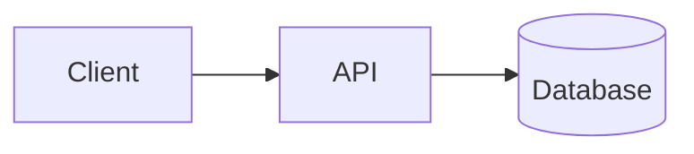

# Zensical Skill

`zensical` is a modern, fast static documentation site generator built in Rust
and Python by the creators of *Material for MkDocs* and *mkdocstrings*. It
replaces legacy `mkdocs.yml` configurations with clean, typed `zensical.toml`
files, instant live reloading, and native support for Mermaid diagrams, MathJax
math, and `mkdocstrings`.

In Zenith projects, `zensical` manages all public documentation and API
references.

---

## 1. Core CLI Commands

Serve documentation locally or compile production static sites.

```bash
uv run zensical serve                  # Start live-reloading dev server
uv run zensical serve --strict         # Fail immediately on broken links
uv run zensical build                  # Build static site into site/
uv run zensical build --strict --clean # Production build with strict checks
```

In Zenith, canonical tasks are wired into Poe:

```bash
uv run poe docs-serve                  # Runs zensical serve --strict
uv run poe docs-build                  # Runs zensical build --strict --clean
```

---

## 2. Configuration & Where It Lives

Zensical is configured via **`zensical.toml`** at the project root:

```toml
[project]
site_name = "My Project"
site_description = "A modern Python project"
site_author = "Jane Developer"
site_url = "https://username.github.io/my-project/"
repo_name = "username/my-project"
repo_url = "https://github.com/username/my-project"
edit_uri = "edit/main/docs/"

# Documentation Navigation Hierarchy
nav = [
    { "Get Started" = "index.md" },
    { "Guide" = "getting-started.md" },
    { "Reference" = "reference.md" },
]

# Strict Build-Time Validation
[project.validation]
invalid_links = true
invalid_link_anchors = true
unresolved_references = true
unresolved_footnotes = true
unused_definitions = true
unused_footnotes = true
shadowed_definitions = true
shadowed_footnotes = true

# Client-Side JavaScript (e.g. MathJax)
extra_javascript = [
    "javascripts/mathjax.js",
    "https://unpkg.com/mathjax@3/es5/tex-mml-chtml.js",
]

# Theme & Palette Settings
[project.theme]
language = "en"
logo = "assets/python-logo.svg"
features = [
    "navigation.instant",
    "navigation.top",
    "content.code.copy",
    "content.code.select",
    "search.highlight",
]

[[project.theme.palette]]
media = "(prefers-color-scheme)"
toggle.icon = "lucide/sun-moon"
toggle.name = "Switch to light mode"

[[project.theme.palette]]
media = "(prefers-color-scheme: light)"
scheme = "default"
toggle.icon = "lucide/sun"
toggle.name = "Switch to dark mode"

[[project.theme.palette]]
media = "(prefers-color-scheme: dark)"
scheme = "slate"
toggle.icon = "lucide/moon"
toggle.name = "Switch to system preference"

# Markdown Extensions & SuperFences
[project.markdown_extensions]
admonition = {}
pymdownx.arithmatex.generic = true
pymdownx.highlight.anchor_linenums = true
pymdownx.snippets.check_paths = true
pymdownx.superfences.custom_fences = [
    { name = "mermaid", class = "mermaid",
      format = "pymdownx.superfences.fence_code_format" },
    { name = "python", class = "python",
      validator = "markdown_exec.validator",
      format = "markdown_exec.formatter" },
]

# mkdocstrings Plugin
[project.plugins.mkdocstrings]
default_handler = "python"

[project.plugins.mkdocstrings.handlers.python]
inventories = ["https://docs.python.org/3/objects.inv"]
paths = ["src"]
options.docstring_options.ignore_init_summary = true
options.docstring_style = "numpy"
options.merge_init_into_class = true
options.parameter_headings = true
options.separate_signature = true
options.show_root_heading = true
options.show_signature_annotations = true
options.show_source = true
options.show_symbol_type_heading = true
options.show_symbol_type_toc = true
options.signature_crossrefs = true
```

---

## 3. Most Common Configuration Changes During Development

Manage pages, navigation, automated API docs, and interactive diagrams with
these patterns.

### A. Adding a New Documentation Page

1. Create the markdown file inside `docs/` (e.g., `docs/architecture.md`).
2. Register the page in `project.nav` in `zensical.toml`:

   ```toml
   nav = [
       { "Get Started" = "index.md" },
       { "Guide" = "getting-started.md" },
       { "Architecture" = "architecture.md" },
       { "Reference" = "reference.md" },
   ]
   ```

3. For nested sections:

   ```toml
   nav = [
       { "Home" = "index.md" },
       { "Guides" = [
           { "Installation" = "guides/install.md" },
           { "Deployment" = "guides/deploy.md" },
       ] },
   ]
   ```

### B. Auto-Documenting Python Code with `mkdocstrings`

In any markdown document (e.g. `docs/reference.md`), use the `:::` block:

```markdown
# API Reference

::: my_package.core
    options:
      show_source: true
      members:
        - get_greeting
```

Zensical automatically reloads docs when source files in `src/` change. With
`inventories = ["https://docs.python.org/3/objects.inv"]` and
`signature_crossrefs = true`, standard library types in signatures link
directly to official Python documentation.

### C. Using Mermaid Diagrams

Mermaid is built into Zensical natively. Write standard markdown fences:

````markdown

````

### D. Dynamic Code Execution with `markdown-exec`

To execute code at doc build time and display live terminal output:

````markdown
```python exec="on"
import sys

print(f"Built with Python {sys.version.split()[0]}")
```
````

### E. Embedding Tested Code Snippets with `pymdownx.snippets`

Embed external source or test files directly into documentation using `--8<--`
with `pymdownx.snippets.check_paths = true` (which fails the build if a
referenced file path does not exist):

````markdown
```python
--8<-- "examples/quickstart.py"
```
````

---

## 4. Best Practices & Troubleshooting

Keep these principles in mind when maintaining documentation:

- **Always build with `--strict`**: Running `uv run poe docs-build`
  validates all internal links, anchors, and docstring references. Never
  deploy a build with broken links.
- **Image Paths**: Keep asset images in `docs/assets/` and reference them
  using relative paths (`assets/my-image.png`).
