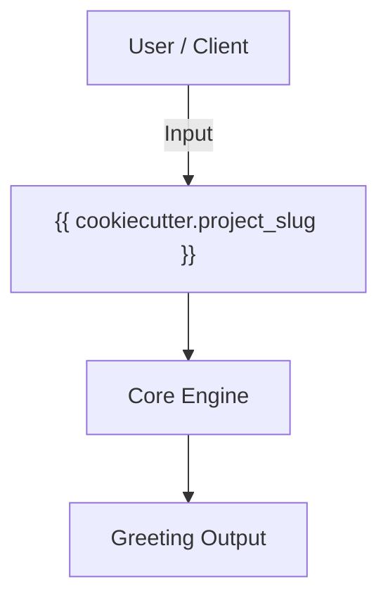
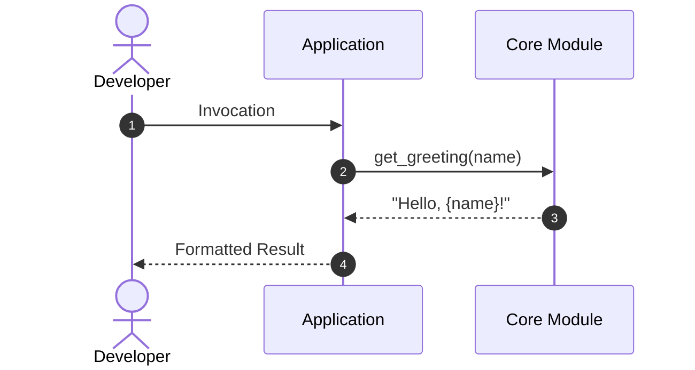
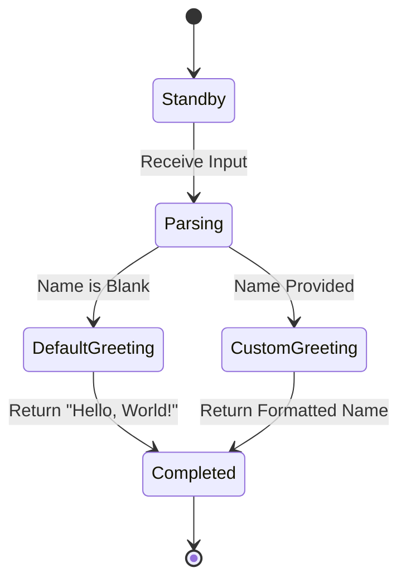

# Getting Started

This guide explains how to install and develop with **{{ cookiecutter.project_name }}**.

## Prerequisites

Ensure you have Python {{ cookiecutter.python_version }} and `uv` installed.

## Installation

Install using `uv`:

```bash
uv add {{ cookiecutter.project_slug }}
```

## Basic Usage

Import the primary functions into your application:

```python
from {{ cookiecutter.package_name }} import get_greeting

message = get_greeting("Developer")
print(message)
```


## CLI Usage

Run commands directly via `uv`:

```bash
uv run {{ cookiecutter.project_slug }} greet "World"
```


## Development Workflow

Clone the project and synchronize development dependencies:

```bash
git clone https://github.com/{{ cookiecutter.github_username }}/{{ cookiecutter.project_slug }}.git
cd {{ cookiecutter.project_slug }}
uv sync
```

Run test suites and quality checks with Poe the Poet:

```bash
# Run tests
uv run poe test

# Run quality checks
uv run poe code-quality
```

## Architecture & Diagrams

Mermaid diagrams render natively in documentation. Below are examples illustrating
the project structure, execution sequence, and state lifecycle:

### Component Architecture



### Execution Lifecycle



### State Lifecycle


