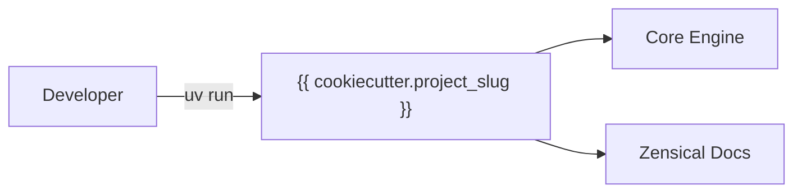

# {{ cookiecutter.project_name }}

<p align="center">
  
</p>

Welcome to the documentation for **{{ cookiecutter.project_name }}**.

{{ cookiecutter.description }}



## Highlights

- **Package Manager**: [uv](https://github.com/astral-sh/uv)
- **Code Formatting & Linting**: [Ruff](https://github.com/astral-sh/ruff)
- **Static Typing**: [Pyrefly](https://github.com/facebook/pyrefly)
- **Complexity Analysis**: [complexipy](https://github.com/rohaquinlop/complexipy)
- **Markdown Linting**: [rumdl](https://github.com/rvben/rumdl)
- **Architecture Enforcement**: [Tach](https://github.com/gauge-sh/tach)
- **Task Runner**: [Poe the Poet](https://github.com/nat-n/poethepoet)
- **Executable Docs**: [markdown-exec](https://github.com/pawamoy/markdown-exec)
- **API Documentation**: [mkdocstrings](https://mkdocstrings.github.io/)
- **Diagrams & Visualizations**: [Mermaid](https://mermaid.js.org/)
- **Document Typography**: [Typst](https://typst.app/)

## Mathematical Notation

LaTeX equations are fully supported via MathJax:

$$
f(x) = \int_{-\infty}^\infty \hat{f}(\xi)\,e^{2 \pi i \xi x}\,d\xi
$$

Inline equations such as $E = mc^2$ and $\mathcal{O}(n \log n)$ render smoothly.

## Dynamic Code Execution

Execute embedded Python and shell snippets at documentation build time:

```python exec="on"
import sys

print(f"Docs built with Python {sys.version.split()[0]} via markdown-exec!")
```

## Next Steps

- Explore the [Guide](getting-started.md) to set up your environment.
- Review the [API Reference](reference.md) for module details.
