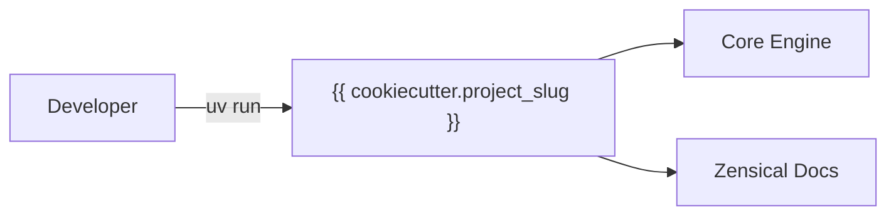

# {{ cookiecutter.project_name }}

<p align="center">
  
</p>

Welcome to the documentation for **{{ cookiecutter.project_name }}**.

{{ cookiecutter.description }}




## Quick Start CLI

<div class="termy">

```console
$ uv run {{ cookiecutter.project_slug }} greet "World"

✨ Hello, World!

// Inspect CLI options and help
$ uv run {{ cookiecutter.project_slug }} --help

<b>Usage: </b><b>{{ cookiecutter.project_slug }} [OPTIONS] COMMAND [ARGS]...</b>

╭─ Options ─────────────────────────────────────────╮
│ --version  -v        Show version and exit.       │
│ --help               Show this message and exit.  │
╰───────────────────────────────────────────────────╯
╭─ Commands ────────────────────────────────────────╮
│ greet                Display a personalized       │
│                      greeting.                    │
╰───────────────────────────────────────────────────╯
```

</div>


## Highlights



## Mathematical Notation

LaTeX equations are fully supported via MathJax:

$$
f(x) = \int_{-\infty}^\infty \hat{f}(\xi)\,e^{2 \pi i \xi x}\,d\xi
$$

Inline equations such as $E = mc^2$ and $\mathcal{O}(n \log n)$ render smoothly.

## Dynamic Code Execution

Execute embedded Python and shell snippets at documentation build time:

```python exec="on"
import sys

print(f"Docs built with Python {sys.version.split()[0]} via markdown-exec!")
```

## Next Steps

- Explore the [Guide](getting-started.md) to set up your environment.
- Review the [API Reference](reference.md) for module details.
